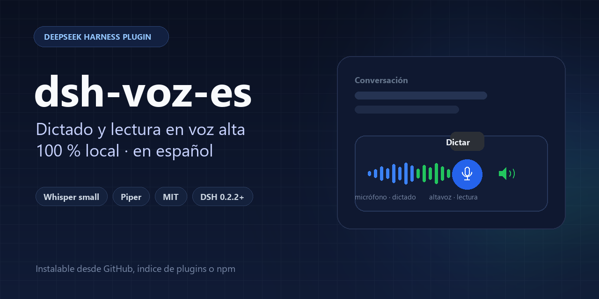
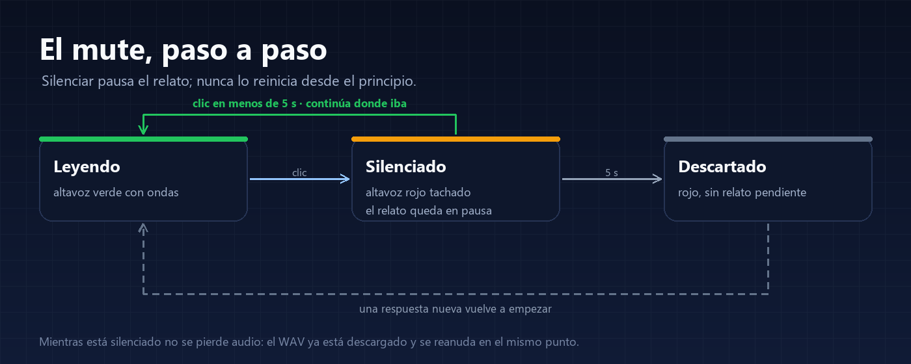
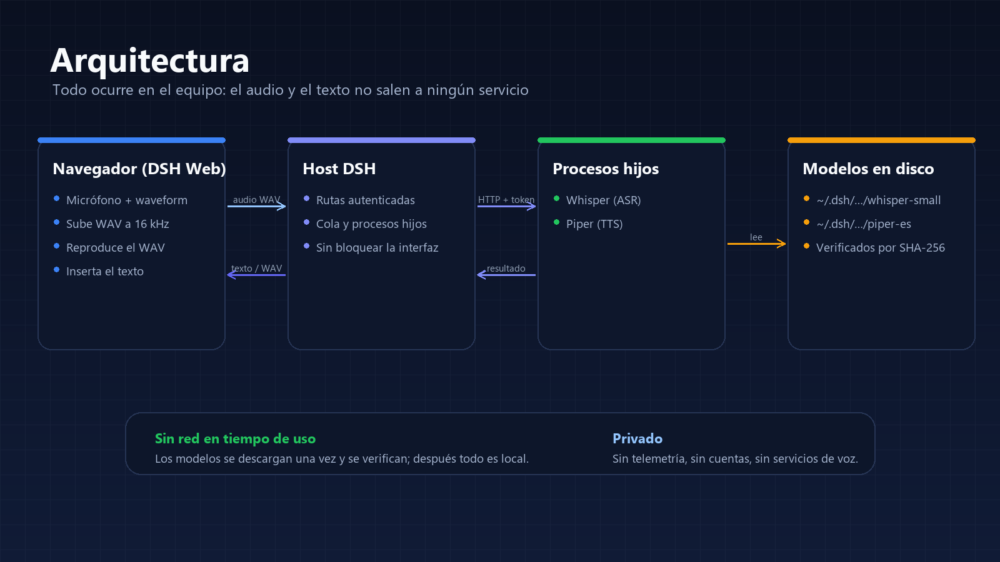

[English](README.md) | **Español**

<p align="center">
  
</p>

<p align="center">
  <a href="https://github.com/Navasfj/dsh-voz-es/actions/workflows/ci.yml"></a>
  
  
  
  
</p>

**Voz en español para [DeepSeek Harness](https://github.com/deepseek-ai/deepseek-harness), sin nube.**
Dicta con Whisper local y escucha las respuestas con Piper, con modelos verificados por SHA-256 y pausa/reanudación real.

---

## Por qué existe

- El audio que trae DSH de serie (SenseVoice) **no reconoce español**.
- Las voces que expone el navegador en Windows (SAPI) **suenan enlatadas**.
- Las alternativas habitualmente **mandan el audio a la nube**.

Este repositorio resuelve las tres cosas con dos plugins que se instalan en DSH y funcionan en tu equipo.

## Qué incluye

| Plugin | Qué hace |
|---|---|
| **`dsh-whisper-voice`** | Añade un micrófono que dicta con **Whisper** (ONNX, sherpa-onnx) en español. El texto se inserta en el borrador sin borrar lo escrito. |
| **`dsh-read-aloud`** | Lee las respuestas con **Piper** (voz neuronal local). Botón junto al micrófono: verde = lee, rojo tachado = silencio. Silenciar **pausa** de verdad y reanudar continúa donde iba; a los 5 s descarta. |

**Detalles que marcan la diferencia**

- **Local de verdad**: la inferencia ocurre en tu CPU; no hay cuentas, telemetría ni servicios de voz.
- **Descarga verificada**: cada peso se fija por revisión, tamaño y SHA-256.
- **Pausa/reanudación real** con un elemento de audio, no con la síntesis del navegador.
- **El dictado silencia la lectura** mientras el micrófono graba y la reanuda al terminar; **enviar** un mensaje corta la narración y pasa a la respuesta nueva.
- **Prefetch** del siguiente fragmento: las respuestas largas no tienen silencios.
- **Sin tocar el núcleo**: todo va por los puntos de extensión de DSH (slots, `speechToText`, rutas autenticadas).

## Instalación

### Requisitos

- **DSH 0.2.2.x** (probado en `0.2.2-rc.2` y `0.2.2-rc.3`).
- `sherpa-onnx-node`, incluido en la instalación de DSH.
- Para el dictado, activa antes el bundle **Voice input** de DSH (Plugins): el plugin de Whisper ajusta sus filas y necesita que existan.
- Windows 11 probado. El motor soporta macOS y Linux; aún sin probar.

### Desde el índice de plugins (recomendado)

Activa el bundle de **índices personalizados**, añade esta URL en Discover y verás las fichas con botón de instalar:

```
https://raw.githubusercontent.com/Navasfj/dsh-voz-es/main/index.json
```

### Desde Git

Fijado a un commit (el que quieras publicar):

```
git+https://github.com/Navasfj/dsh-voz-es.git#<commit>&path:/packages/dsh-read-aloud
git+https://github.com/Navasfj/dsh-voz-es.git#<commit>&path:/packages/dsh-whisper-voice
```

Orden para el dictado: **Voice input** primero y después `dsh-whisper-voice`.

### Desde npm (opcional)

```bash
cd packages/dsh-read-aloud && npm publish --access public
cd ../dsh-whisper-voice && npm publish --access public
```

Después: `@navasfj/dsh-read-aloud@1.0.0` y `@navasfj/dsh-whisper-voice@1.0.0`.

## Uso

| Acción | Cómo |
|---|---|
| **Dictar** | Pulsa el micrófono entre el selector de modelo y Enviar, habla y pulsa Detener. El texto se inserta en el cursor sin borrar lo que ya hay. |
| **Leer** | Pulsa el altavoz junto al micrófono. Verde con ondas = leyendo; rojo tachado = silenciado. |
| **Pausar** | Pulsa el altavoz una vez. Vuelve a pulsarlo en menos de 5 s para continuar. |
| **Descartar** | Deja el mute más de 5 s: al reactivar no reanuda el relato anterior. |

### El mute, paso a paso

<p align="center">
  
</p>

- **Verde**: está leyendo.
- **Clic**: pausa el audio en el punto exacto, sin reiniciar ni volver a sintetizar.
- **Clic en menos de 5 s**: continúa donde iba, sin repetir la frase.
- **5 s sin reanudar**: descarta el relato pendiente. El botón sigue en rojo y la siguiente respuesta empieza de cero.

El audio no se pierde al pausar: el WAV ya está descargado en el navegador. Si una respuesta termina mientras está silenciado, no se lee después.

Guía completa, con el dictado paso a paso, qué lee y qué no, límites y preguntas frecuentes: **[docs/USAGE.md](docs/USAGE.md)** ([English](docs/USAGE.en.md)).

## Arquitectura

<p align="center">
  
</p>

- El navegador captura a **16 kHz mono** y sube el WAV por el canal autenticado de DSH.
- El Host encola el trabajo y lo pasa a un **proceso hijo** (Whisper o Piper) por loopback con token.
- La lectura devuelve un WAV que el navegador reproduce con un elemento de audio.
- Los modelos viven en `%USERPROFILE%\.dsh\...` y se verifican antes de usarse.

## Configuración

Cada plugin se ajusta en su fila de `cordis.patch.yml`:

```yaml
- insert:
    - id: speech-to-text-whisper
      name: "@navasfj/dsh-whisper-voice"
      config:
        model: small        # tiny | base | small (por defecto small)
        language: es
        threads: 4

    - id: ui-read-aloud
      name: "@navasfj/dsh-read-aloud"
      config:
        speed: 0.9          # 0.8 más lento, 1.0 ritmo natural
        threads: 4
```

`modelDirectory` permite usar pesos ya presentes en disco; entonces no se descarga nada.

## Modelos y caché

| Modelo | Tamaño | Ruta |
|---|---|---|
| Whisper `small` INT8 | ~375 MB | `~/.dsh/speech-to-text/whisper/models/whisper-small` |
| Piper `es_ES-sharvard-medium` + espeak | ~77 MB | `~/.dsh/read-aloud/models/piper-es-sharvard` |

La primera vez que se usa cada plugin se descarga su modelo. Desinstalar el plugin no borra la caché.

## Privacidad

- El audio va del navegador al Host por el canal autenticado de DSH y de ahí al proceso local de Whisper.
- La lectura sintetiza en el Host con Piper; el navegador solo reproduce el WAV.
- Sin telemetría, sin cuentas, sin servicios de voz. La única red es la descarga inicial del modelo.

## Problemas frecuentes

| Síntoma | Causa y solución |
|---|---|
| No aparece el micrófono | El bundle **Voice input** no está activo o no se recargó la página. Actívalo y recarga con Ctrl+Shift+R. |
| El micrófono aparece pero no transcribe | Falta el modelo o el proceso de Whisper no arrancó. Mira Plugins → Voz con Whisper y la consola del navegador. |
| La lectura no suena | Comprueba que el botón está verde; si acabas de instalar, espera a que termine la descarga del modelo. |
| La primera transcripción tarda | `small` carga el modelo en el primer uso; después queda caliente. Con `base` es más rápido y menos preciso. |
| Descarga bloqueada | Usa `modelDirectory` con los pesos ya descargados, o revisa el acceso a Hugging Face. |

## Desarrollo

```bash
# Sintaxis de los plugins
node --check packages/dsh-whisper-voice/index.js
node --check packages/dsh-whisper-voice/worker.js
node --check packages/dsh-read-aloud/index.js
node --check packages/dsh-read-aloud/tts-worker.js
node --check packages/dsh-read-aloud/client.js

# Regenerar imágenes
python scripts/make-assets.py

# Regenerar el índice de Discover (fija el commit actual)
node scripts/make-index.mjs
```

Guía para contribuir: [CONTRIBUTING.md](CONTRIBUTING.md). Para reportar vulnerabilidades: [SECURITY.md](SECURITY.md).

## Licencia y atribuciones

Código **MIT** — ver [LICENSE](LICENSE). Los modelos y el runtime tienen sus propias licencias (Piper, espeak-ng, Whisper, sherpa-onnx): ver [NOTICE.md](NOTICE.md).
