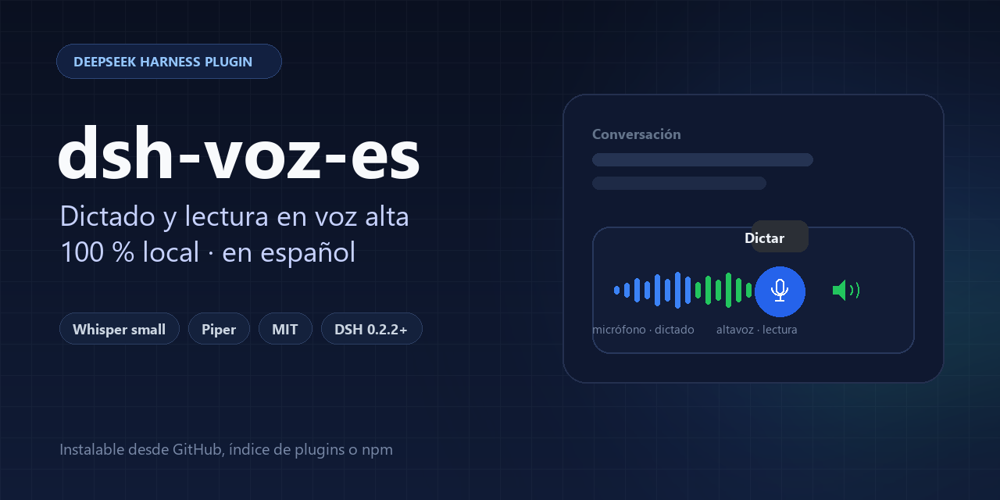
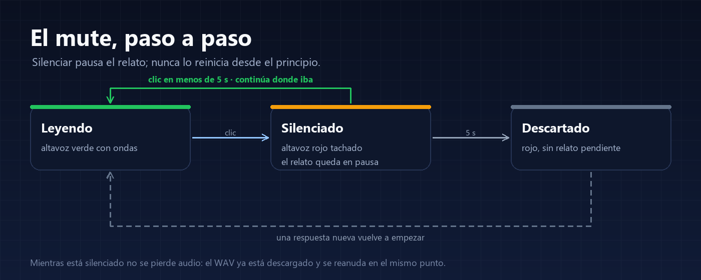
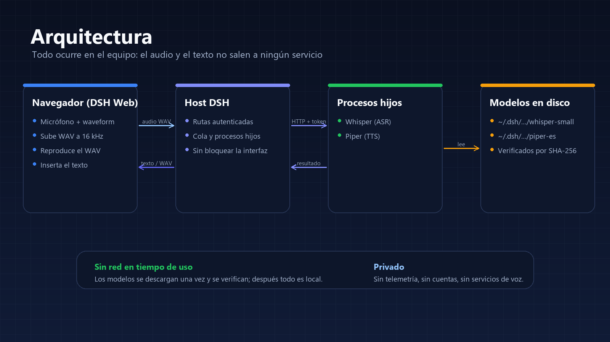

**English** | [Español](README.es.md)

<p align="center">
  
</p>

<p align="center">
  <a href="https://github.com/Navasfj/dsh-voz-es/actions/workflows/ci.yml"></a>
  
  
  
  
</p>

**Local Spanish voice for [DeepSeek Harness](https://github.com/deepseek-ai/deepseek-harness), without the cloud.**
Dictate with on-device Whisper and listen to replies with Piper, with SHA-256-verified models and true pause/resume.

---

## Why it exists

- DSH ships SenseVoice, which **does not recognize Spanish**.
- The voices the browser exposes on Windows (SAPI) **sound robotic**.
- Most alternatives **send your audio to a cloud service**.

This repository fixes all three with two plugins that install into DSH and run on your machine.

## What's inside

| Plugin | What it does |
|---|---|
| **`dsh-whisper-voice`** | Adds a microphone that dictates with **Whisper** (ONNX, sherpa-onnx) in Spanish. The transcript is inserted at the cursor without clearing what you already wrote. |
| **`dsh-read-aloud`** | Reads replies with **Piper** (local neural voice). Button next to the microphone: green = reading, red slashed = muted. Muting **pauses** for real; resuming continues where it stopped; after 5 s it discards. |

**Details that matter**

- **Truly local**: inference runs on your CPU; no accounts, no telemetry, no voice services.
- **Verified downloads**: every weight is pinned by revision, size and SHA-256.
- **Real pause/resume** with an audio element, not the browser's speech synthesis.
- **Dictation silences the narration** while the microphone records and resumes when it stops; **sending** a message cuts the narration and moves on to the new reply.
- **Prefetch**: the next fragment is synthesized while the current one plays, so long replies have no gaps.
- **No core changes**: everything goes through DSH extension points (slots, `speechToText`, authenticated routes).

## Installation

### Requirements

- **DSH 0.2.2.x** (tested on `0.2.2-rc.2` and `0.2.2-rc.3`).
- `sherpa-onnx-node`, shipped with the DSH installation.
- For dictation, enable DSH's **Voice input** bundle first (Plugins): the Whisper provider adjusts its rows and needs them to exist.
- Tested on Windows 11. The engine supports macOS and Linux; not tested there yet.

### From the plugin index (recommended)

Enable the **custom plugin indexes** bundle, add this URL in Discover, and install from the card:

```
https://raw.githubusercontent.com/Navasfj/dsh-voz-es/main/index.json
```

### From Git

Pinned to a commit (the one you want to publish):

```
git+https://github.com/Navasfj/dsh-voz-es.git#<commit>&path:/packages/dsh-read-aloud
git+https://github.com/Navasfj/dsh-voz-es.git#<commit>&path:/packages/dsh-whisper-voice
```

Order for dictation: **Voice input** first, then `dsh-whisper-voice`.

### From npm (optional)

```bash
cd packages/dsh-read-aloud && npm publish --access public
cd ../dsh-whisper-voice && npm publish --access public
```

Then `@navasfj/dsh-read-aloud@1.0.0` and `@navasfj/dsh-whisper-voice@1.0.0`.

## Usage

| Action | How |
|---|---|
| **Dictate** | Press the microphone between the model selector and Send, speak, press Stop. The transcript is inserted at the cursor without clearing the draft. |
| **Read** | Press the speaker next to the microphone. Green with waves = reading; red slashed = muted. |
| **Pause** | Press the speaker once. Press it again within 5 s to continue. |
| **Discard** | Leave it muted for more than 5 s: re-enabling does not resume the previous narration. |

### Mute, step by step

<p align="center">
  
</p>

- **Green**: it is reading.
- **Click**: pauses the audio at the exact point, without restarting or re-synthesizing.
- **Click within 5 s**: continues where it stopped, without repeating the sentence.
- **5 s without resuming**: discards the pending narration. The button stays red and the next reply starts fresh.

Audio is not lost on pause: the WAV is already downloaded in the browser. A reply that finishes while muted is not read later.

Full guide with dictation, what is read and what is not, limits and FAQ: **[docs/USAGE.en.md](docs/USAGE.en.md)** ([español](docs/USAGE.md)).

## Architecture

<p align="center">
  
</p>

- The browser captures at **16 kHz mono** and uploads the WAV over DSH's authenticated channel.
- The Host queues the work and hands it to a **child process** (Whisper or Piper) over loopback with a token.
- Reading returns a WAV that the browser plays with an audio element.
- Models live under `%USERPROFILE%\.dsh\...` and are verified before use.

## Configuration

Each plugin is configured in its `cordis.patch.yml` row:

```yaml
- insert:
    - id: speech-to-text-whisper
      name: "@navasfj/dsh-whisper-voice"
      config:
        model: small        # tiny | base | small (default small)
        language: es
        threads: 4

    - id: ui-read-aloud
      name: "@navasfj/dsh-read-aloud"
      config:
        speed: 0.9          # 0.8 slower, 1.0 natural pace
        threads: 4
```

`modelDirectory` lets you use weights already on disk; nothing is downloaded then.

## Models and cache

| Model | Size | Path |
|---|---|---|
| Whisper `small` INT8 | ~375 MB | `~/.dsh/speech-to-text/whisper/models/whisper-small` |
| Piper `es_ES-sharvard-medium` + espeak | ~77 MB | `~/.dsh/read-aloud/models/piper-es-sharvard` |

Each plugin downloads its model on first use. Uninstalling the plugin does not delete the cache.

## Privacy

- Audio goes from the browser to the Host over DSH's authenticated channel and then to the local Whisper process.
- Reading synthesizes in the Host with Piper; the browser only plays the WAV.
- No telemetry, no accounts, no voice services. The only network use is the initial model download.

## Troubleshooting

| Symptom | Cause and fix |
|---|---|
| No microphone appears | The **Voice input** bundle is not enabled or the page was not reloaded. Enable it and press Ctrl+Shift+R. |
| The microphone appears but does not transcribe | The model is missing or the Whisper process did not start. Check Plugins → Whisper voice and the browser console. |
| Reading is silent | Make sure the button is green; if you just installed, wait for the Piper model download. |
| The first transcription is slow | `small` loads the model on first use; it stays warm afterwards. `base` is faster and less accurate. |
| The download is blocked | Use `modelDirectory` with weights already on disk, or check access to Hugging Face. |

## Development

```bash
# Plugin syntax
node --check packages/dsh-whisper-voice/index.js
node --check packages/dsh-whisper-voice/worker.js
node --check packages/dsh-read-aloud/index.js
node --check packages/dsh-read-aloud/tts-worker.js
node --check packages/dsh-read-aloud/client.js

# Regenerate images
python scripts/make-assets.py

# Regenerate the Discover index (pins the current commit)
node scripts/make-index.mjs
```

Contributing: [CONTRIBUTING.md](CONTRIBUTING.md). Reporting vulnerabilities: [SECURITY.md](SECURITY.md).

## License and credits

Code **MIT** — see [LICENSE](LICENSE). Models and runtime keep their own licenses (Piper, espeak-ng, Whisper, sherpa-onnx): see [NOTICE.md](NOTICE.md).
