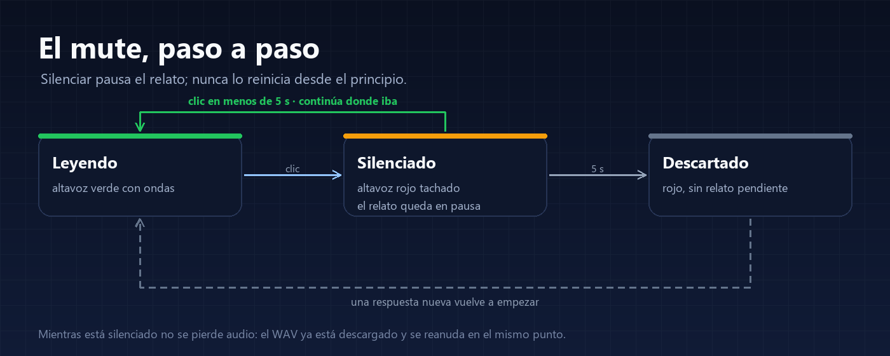

**English** | [Español](USAGE.md)

# Usage guide

This guide explains what each button does, what happens under the hood, and why mute behaves this way.

---

## 1. Dictation (dsh-whisper-voice)

### Before dictating

1. DSH's **Voice input** bundle must be enabled (Plugins). The Whisper provider adjusts its configuration; without it there is no microphone.
2. The first time, DSH downloads the Whisper model (~375 MB with `small`) and verifies it. Status is under **Plugins → Whisper voice**.
3. The browser asks for microphone permission the first time.

### Recording

- Press the **microphone** between the model selector and **Send**.
- The recording bar shows the **waveform**: 80 bars reacting to the audio level in real time. If you don't speak, they stay nearly flat; that is information too.
- Press **Stop** when done (or **Cancel** to discard).
- While transcribing you see the working indicator. When it finishes, the text is **inserted into the draft at the cursor**, without clearing or replacing what you already wrote.

### If you change the draft while recording

The text is not inserted automatically: **Insert** or discard appears next to the microphone, so your typing during the recording is not overwritten.

### Limits and quality

- Max recording: **120 seconds** and **4 MB** of WAV.
- The browser converts to **16 kHz mono**; the Host validates the WAV before transcribing.
- Models: `tiny` (103 MB, fast and loose), `base` (160 MB, very clear dictation) and `small` (375 MB, the default). With `small` an 8 s sentence takes about 7 s on CPU; with `base`, about 2 s.
- Language: `es` by default. `auto` lets Whisper detect it.

### Under the hood

1. The browser records and encodes the WAV.
2. It uploads it to the Host over DSH's authenticated channel.
3. The Host hands it to a **child process** with Whisper (sherpa-onnx) so the UI is not blocked.
4. The text comes back and is inserted into the draft.

Audio is **transient**: it is not stored as a session event or an attachment. Only what you send enters the conversation.

---

## 2. Read aloud (dsh-read-aloud)

### The button and its two states

- **Green speaker with waves**: active. Reads replies as they finish.
- **Red slashed speaker**: muted.
- The tooltip says **Read** or **Mute**. The preference is stored in the browser: if you leave it active, it stays active after reloading.

### What it reads and what it doesn't

- It reads only **settled** (finished) replies, not text halfway through streaming.
- It reads only **visible text blocks**: it skips reasoning, tool calls and code blocks.
- It does not read your messages or the history from before you enabled it.

### Mute, in detail

<p align="center">
  
</p>

1. **Reading** (green): the reply plays.
2. **One click**: **Muted** (red). Audio **pauses** at the exact point; it does not restart or re-synthesize.
3. **Click within 5 seconds**: back to **Reading** and continues exactly where it stopped. It does not repeat the sentence.
4. **5 seconds without resuming**: the pending narration is **discarded**. The button stays red; pressing it plays nothing and it waits for the next reply.

Why that limit: a narration paused forever becomes confusing ("what was this about?"). Five seconds cover an accidental mute and avoid resuming something from half an hour ago.

Worth knowing:

- **Audio is not lost**: the fragment's WAV is already downloaded in the browser; the pause is on the audio element.
- A reply that finishes while muted is **not read later**: it counts as seen and the next narration starts with the next reply.
- Changing session or closing the conversation stops and clears the reading.

### Dictating or typing while it reads

You can add a comment (spoken or typed) without losing the rest of the reply:

- When recording starts, reading **pauses by itself** so the microphone does not capture the speaker.
- When recording ends, if you **have not sent** the message, reading **continues** where it stopped and finishes.
- As soon as you **send** a message (dictated or typed), the current reading is **cut** and moves on to the new reply.
- Muting with the speaker is different: the 5-second mute limit applies there.

### Long replies

Text is split into requests of up to 800 characters. While a fragment plays, the next one is **already being synthesized** (prefetch), so there are no silences between chunks. The first sentence of each session takes a bit longer: the model has to load.

### Settings

```yaml
- id: ui-read-aloud
  name: "@navasfj/dsh-read-aloud"
  config:
    speed: 0.9      # 0.8 slower, 1.0 natural pace
    threads: 4      # CPU threads for synthesis
```

The voice is Piper `es_ES-sharvard-medium` (female, 22 kHz). Switching to another Piper voice means changing the model and its assets; open an issue if you are interested.

---

## 3. Privacy

- Microphone audio goes from the browser to the Host over DSH's authenticated channel and then to the local Whisper process.
- Reading synthesizes in the Host with Piper; the browser only plays the WAV.
- No telemetry, no accounts and no voice services.
- The only network use is the **initial download** of the models from Hugging Face, verified by size and SHA-256.

---

## 4. FAQ

**No microphone appears.**
The Voice input bundle is not enabled or the page was not reloaded. Enable it in Plugins and press Ctrl+Shift+R.

**The microphone appears but does not transcribe.**
Check Plugins → Whisper voice: model downloaded, ready state and errors. If you just installed it, wait for the download to finish.

**Reading is silent.**
Make sure the button is green. If you just installed, wait for the Piper model download. Check the system volume too.

**I muted it and it does not continue.**
More than 5 seconds passed: that is the intended behavior. Press the button and wait for the next reply.

**Can the speed be changed?**
Yes, with `speed` in the plugin configuration (0.8–1.0).

**Dictation repeats the same sentence several times.**
It was a Whisper loop triggered by silence. The plugin now trims leading and trailing silence and collapses repeated sentences; if it still happens, dictate without long pauses before speaking or at the end.

**Does it work offline?**
Yes, once the models are downloaded. The first setup needs network.
