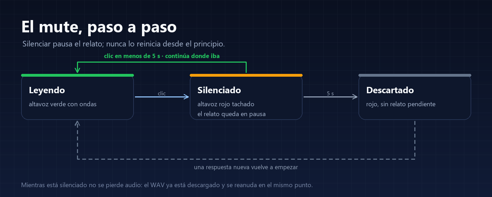

# Guía de uso

Esta guía explica qué hace cada botón, qué ocurre por dentro y por qué el mute se comporta así.

---

## 1. Dictado (dsh-whisper-voice)

### Antes de dictar

1. El bundle **Voice input** de DSH debe estar activo (Plugins). El plugin de Whisper ajusta su configuración; sin él no hay micrófono.
2. La primera vez, DSH descarga el modelo de Whisper (~375 MB con `small`) y lo verifica. El estado se ve en **Plugins → Voz con Whisper**.
3. El navegador pedirá permiso de micrófono la primera vez.

### Grabar

- Pulsa el **micrófono** entre el selector de modelo y **Enviar**.
- Aparece la barra de grabación con la **waveform**: 80 barras que reaccionan a la intensidad del audio en tiempo real. Si no hablas, quedan casi planas; eso también es información.
- Pulsa **Detener** al terminar (o **Cancelar** para descartar).
- Mientras transcribe verás el indicador de trabajo. Al terminar, el texto **se inserta en el borrador en la posición del cursor**, sin borrar ni sustituir lo que ya hubiera escrito.

### Si cambias el borrador mientras grabas

El texto no se inserta solo: aparece **Insertar** o descartar junto al micrófono. Así no se pisa lo que hayas escrito durante la grabación.

### Límites y calidad

- Grabación máxima: **120 segundos** y **4 MB** de WAV.
- El navegador convierte a **16 kHz mono**; el Host valida el WAV antes de transcribir.
- Modelos: `tiny` (103 MB, rápido y flojo), `base` (160 MB, dictado muy claro) y `small` (375 MB, el valor por defecto). Con `small` una frase de 8 s tarda unos 7 s en CPU; con `base`, unos 2 s.
- Idioma: `es` por defecto. `auto` deja que Whisper lo detecte.

### Qué ocurre por dentro

1. El navegador graba y codifica el WAV.
2. Lo envía al Host por el canal autenticado de DSH.
3. El Host lo pasa a un **proceso hijo** con Whisper (sherpa-onnx) para no bloquear la interfaz.
4. Vuelve el texto y se inserta en el borrador.

El audio es **transitorio**: no se guarda como evento de sesión ni como adjunto. Solo entra en la conversación lo que tú envíes.

---

## 2. Lectura en voz alta (dsh-read-aloud)

### El botón y sus dos estados

- **Altavoz verde con ondas**: activo. Lee las respuestas que terminan.
- **Altavoz rojo tachado**: silenciado.
- El tooltip dice **Leer** o **Silenciar**. La preferencia se guarda en el navegador: si lo dejas activo, sigue activo tras recargar.

### Qué lee y qué no

- Lee solo respuestas **asentadas** (terminadas), no texto a medias mientras se escribe.
- Lee solo los **bloques de texto visibles**: omite razonamiento, llamadas a herramientas y bloques de código.
- No lee tus mensajes ni el historial anterior al activarlo.

### El mute, en detalle

<p align="center">
  
</p>

1. **Leyendo** (verde): suena la respuesta.
2. **Un clic**: pasa a **Silenciado** (rojo). El audio se **pausa** en el punto exacto; no se reinicia ni se vuelve a sintetizar.
3. **Clic en menos de 5 segundos**: vuelve a **Leyendo** y continúa exactamente donde iba. No repite la frase.
4. **5 segundos sin reanudar**: el relato pendiente se **descarta**. El botón sigue en rojo; al pulsarlo ya no suena nada y queda listo para la siguiente respuesta.

Por qué ese límite: un relato pausado indefinidamente acaba siendo confuso («¿esto de qué era?»). Cinco segundos cubren el silenciar accidental y evitan reanudar algo de hace media hora.

Detalles que conviene saber:

- **No se pierde audio**: el WAV del fragmento ya está descargado en el navegador; la pausa es del elemento de audio.
- Si una respuesta termina mientras está silenciado, **no se lee después**: cuenta como vista y el siguiente relato empieza con la siguiente respuesta.
- Al cambiar de sesión o cerrar la conversación, la lectura se detiene y se limpia.

### Dictar mientras lee

Si empiezas a dictar mientras suena una respuesta, la lectura **se pausa sola** en cuanto el micrófono empieza a capturar: si no, el micro grabaría también el altavoz y el texto saldría mezclado.

- Al terminar la grabación, la lectura **no se reanuda**: el relato interrumpido se descarta en ese momento.
- Así puedes escribir o enviar lo dictado sin que la voz vuelva por encima. La siguiente respuesta sí se lee con normalidad.

### Respuestas largas

El texto se trocea en peticiones de hasta 800 caracteres. Mientras suena un fragmento, el siguiente **ya se está sintetizando** (prefetch), así que no hay silencios entre trozos. La primera frase de cada sesión tarda algo más: hay que cargar el modelo.

### Ajustes

```yaml
- id: ui-read-aloud
  name: "@navasfj/dsh-read-aloud"
  config:
    speed: 0.9      # 0.8 más lento, 1.0 ritmo natural
    threads: 4      # hilos de CPU para la síntesis
```

La voz es Piper `es_ES-sharvard-medium` (femenina, 22 kHz). Cambiar a otra voz de Piper implica cambiar el modelo y sus assets; abre un issue si te interesa.

---

## 3. Privacidad

- El audio del micrófono va del navegador al Host por el canal autenticado de DSH y de ahí al proceso local de Whisper.
- La lectura sintetiza en el Host con Piper; el navegador solo reproduce el WAV.
- Sin telemetría, sin cuentas y sin servicios de voz.
- La única red que se usa es la **descarga inicial** de los modelos desde Hugging Face, verificada por tamaño y SHA-256.

---

## 4. Preguntas frecuentes

**No aparece el micrófono.**
El bundle Voice input no está activo o la página no se recargó. Actívalo en Plugins y recarga con Ctrl+Shift+R.

**El micrófono aparece pero no transcribe.**
Mira Plugins → Voz con Whisper: modelo descargado, estado listo y errores. Si acabas de instalar, espera a que termine la descarga.

**La lectura no suena.**
Comprueba que el botón está verde. Si acabas de instalar, espera a que se descargue el modelo de Piper. Revisa también el volumen del sistema.

**He silenciado y al volver ya no sigue.**
Han pasado más de 5 segundos: es el comportamiento previsto. Pulsa el botón y espera la siguiente respuesta.

**¿Se puede cambiar la velocidad?**
Sí, con `speed` en la configuración del plugin (0.8–1.0).

**El dictado repite la misma frase varias veces.**
Era un bucle de Whisper al encontrarse silencio. El plugin ahora recorta el silencio inicial y final de la grabación y colapsa las frases repetidas; si aun así aparece, dicta sin dejar pausas largas antes de hablar o al terminar.

**¿Funciona sin internet?**
Sí, una vez descargados los modelos. La primera preparación necesita red.
